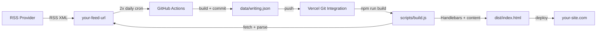

# lean-rss-feed-website

A writing-first personal website powered by any RSS feed. Also easy to add your selected projects to it.

Fork it, set your RSS URL, deploy. Made for those willing to spend time building content, projects, and an audience, not figuring out complex frontend frameworks.



## How it works

- A build script fetches any RSS feed and parses it into posts
- Handlebars renders the template with your content (bio, work, posts)
- Output is a single `index.html` -- no server, no database
- GitHub Actions runs twice daily, commits new writing data, pushes;
  the Vercel Git integration deploys the push automatically

## Quick start

```bash
npm install
npm run build
open dist/index.html
```

## Configure

Three data files (all gitignored, copy from `.example.json`):

| File | Purpose |
|------|---------|
| `data/content.json` | Site config, bio, links, RSS URL |
| `data/writing.json` | Auto-generated by build from RSS. Review before rebuild. |
| `data/work.json` | Selected work/projects, manually filled. |

Each has a `.example.json` counterpart in the repo. Copy them to start:

```bash
cp data/content.example.json data/content.json
cp data/work.example.json data/work.json
cp data/writing.example.json data/writing.json
```

The RSS parser currently expects Substack-style XML. If your feed uses different elements, adjust `scripts/build.js` to match.

## Deploy

Connect this repo to Vercel. The daily cron keeps your site in sync with your RSS source.

## Tech

Node.js, Handlebars, RSS, vanilla CSS. One page.
